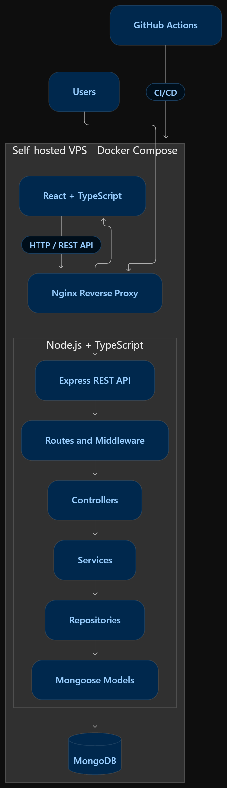

# System Architecture

InAndOut is designed as a modular monolith with a separate React frontend and Express backend.

The frontend communicates with the backend through a REST API. The backend is organized into feature-based modules, with controllers handling HTTP requests, services implementing business logic, and repositories managing database access through Mongoose.

Authentication, authorization, and tenant isolation are enforced by the backend.

The application uses a functional-first TypeScript approach to keep the code simple, maintainable, and testable.

A modular monolith was chosen over microservices to reduce development and deployment complexity while maintaining clear boundaries between business modules.

The application will be deployed on a self-hosted VPS using Docker Compose, with Nginx as a reverse proxy and GitHub Actions for automated testing and deployment.