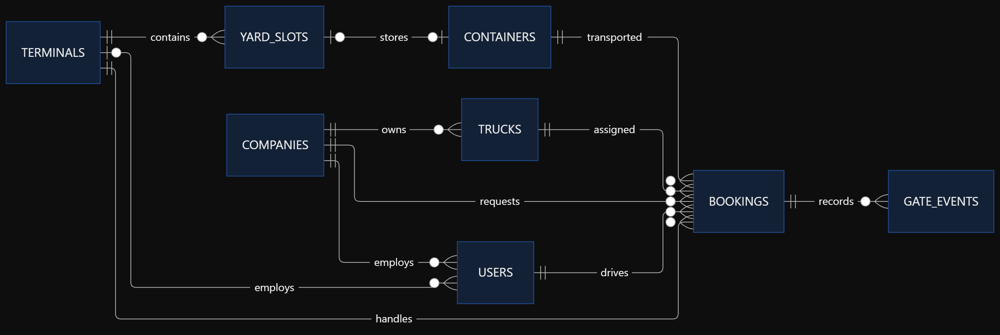

# Database Design

InAndOut uses MongoDB with Mongoose for data persistence.

Core business entities are stored in separate collections because they have independent lifecycles and are queried and updated independently.

Relationships between documents are maintained using ObjectId references. Indexes improve query performance and enforce uniqueness constraints.

Data validation, referential integrity, and tenant isolation are enforced by the backend.

## Database Schema

