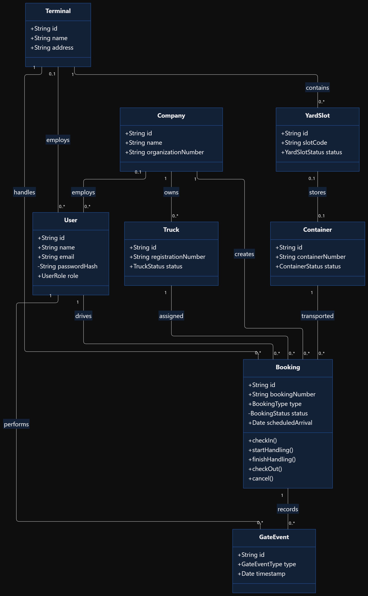

# Domain Model — InAndOut

## Overview

The domain model represents the core business entities,
their responsibilities, and relationships within InAndOut.

## UML Class Diagram

## Design Decisions

- Booking is the central business entity.
- All employees are represented by the User entity.
- Role-based access control determines user permissions.
- Business entities encapsulate critical business rules.
- Composition is preferred over inheritance.
- The domain model evolves incrementally during development.
